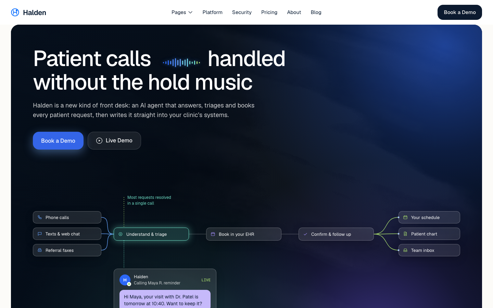

# Halden – AI Healthcare SaaS Template

A free, open-source Next.js template for healthcare, health-tech and AI SaaS websites. It has a calm, modern design with a dark hero, product mockups built in HTML, smooth scroll animations, an MDX blog and legal pages. It is fast and accessible, and you can rebrand it from a few config files.

**Built with:** Next.js 16 (App Router) · React 19 · TypeScript · Tailwind CSS 4 · MDX · next/font · next/image



## Demo

https://halden-nextjs-template.vercel.app

## How to Use

### One-Click Deploy

Deploy the template to Vercel. No environment variables or setup are needed.

[](https://vercel.com/new/clone?repository-url=https%3A%2F%2Fgithub.com%2FWavespaceAgency%2Fhalden-nextjs-template&project-name=halden&repository-name=halden&demo-title=Halden%20%E2%80%93%20AI%20Healthcare%20SaaS%20Template&demo-description=A%20free%20Next.js%20template%20for%20healthcare%20and%20AI%20SaaS%20startups%3A%2011%20pages%2C%20MDX%20blog%2C%20smooth%20animations%20and%20full%20SEO.&demo-url=https%3A%2F%2Fhalden-nextjs-template.vercel.app&demo-image=https%3A%2F%2Fraw.githubusercontent.com%2FWavespaceAgency%2Fhalden-nextjs-template%2Fmain%2F.github%2Fpreview.png)

### Clone and Deploy

```bash
npx create-next-app@latest --example https://github.com/WavespaceAgency/halden-nextjs-template my-site
cd my-site
npm run dev
```

Open [http://localhost:3000](http://localhost:3000). Then deploy it to the cloud with [Vercel](https://vercel.com/new) ([documentation](https://nextjs.org/docs/app/getting-started/deploying)).

## Features

- **11 pages:** Home, Platform, Security, Pricing, About, Blog, Blog Post, Book a Demo, Privacy Policy, Terms of Service and 404
- **Next.js 16 App Router** with Server Components, fully static output (Cache Components) and almost no client JavaScript
- **Responsive** from 320px to 1920px, built from the Halden Figma design
- **Interactive and smooth:** a header that hides on scroll, an animated hero flow diagram, text effects, scroll reveals, count-ups, animated product mockups and springy hovers. Every animation respects `prefers-reduced-motion`
- **MDX blog** with categories, table of contents, author box, related posts, RSS and a generated Open Graph image per post
- **Book a Demo form** using a Server Action, with validation on both client and server, accessible errors and a success state
- **Config-driven:** all text lives in `src/config/`, so components contain no hard-coded copy
- **SEO ready:** Metadata API, canonical URLs, Open Graph and Twitter cards, `sitemap.xml`, `robots.txt`, web manifest and JSON-LD (Organization, WebSite, BlogPosting, BreadcrumbList, FAQPage)
- **Accessible:** skip link, keyboard-friendly menus, tabs and accordions, visible focus rings, labelled form fields and good colour contrast
- Tailwind CSS 4, TypeScript strict, ESLint, `next/font` (Geist) and `next/image` (AVIF/WebP)

## Customization

| I want to change… | Edit |
| --- | --- |
| Site name, navigation, footer links, socials, main button, "Live Demo" link | `src/config/site.ts` |
| Text and data of a page | `src/config/pages/<page>.ts` |
| Closing call-to-action band (above the footer) | `src/config/pages/shared.ts` |
| Colours, font sizes, radii, shadows | `src/app/globals.css` (CSS variables at the top) |
| Fonts | `src/app/fonts.ts` |
| Logo and favicon | `src/components/ui/LogoMark.tsx` and `src/app/icon.svg` |
| Default share image | `src/app/opengraph-image.png` (1200×630) |
| Images | `src/assets/images/<page>/` (imported in the page config) and `public/images/blog/` |
| Blog posts | `src/content/blog/*.mdx` |
| Privacy Policy and Terms | `src/content/legal/*.mdx` |

### Set Your Domain

Set the `NEXT_PUBLIC_SITE_URL` environment variable (for example `https://www.example.com`). It is used for canonical links, Open Graph and the sitemap. On Vercel the production URL is picked up automatically, so you can skip this step there.

### Change the Colours

Open `src/app/globals.css` and edit the variables in `:root`, for example `--brand: #2c67f6;`. Every component uses these tokens through Tailwind classes such as `bg-brand` and `text-ink`.

### Change the Font

Open `src/app/fonts.ts`, import another font from `next/font/google` (for example `Inter`) and keep the `variable` names. next/font hosts the font with your site, so visitors make no request to Google.

### Add a Blog Post

Create `src/content/blog/my-post.mdx`. The file name becomes the URL (`/blog/my-post`). Put the cover image in `public/images/blog/` and copy the frontmatter from an existing post:

```md
---
title: "My post"
excerpt: "One sentence for cards and search engines."
category: "Playbooks"
tags: ["Scheduling"]
date: "2026-11-20"
readingTime: "5 min read"
image: "/images/blog/my-cover.png"
imageAlt: "What the cover shows"
author:
  name: "Jane Cooper"
  role: "Head of Product"
---

Your text in Markdown…

<Quote cite="Name, Company">“A short quote.”</Quote>
```

The `category` must match one of the tabs in `src/config/pages/blog.ts`. The build checks the frontmatter and tells you which field is missing.

### Connect the Forms

The **Book a Demo** form posts to a Server Action in `src/app/book-a-demo/actions.ts`. It validates every field on the server (the same rules as the browser, in `src/components/demo/validation.ts`) and, for now, logs the request to your terminal or the Vercel function logs. Connect your email service, CRM or webhook where the code is marked `TODO`, then remove the log, because it contains personal data. The form also works without JavaScript.

The **newsletter** form in the blog is marked `TODO` in the same way. No API keys are needed to run the template.

### Turn Off Smooth Scrolling

Set `smoothScroll: false` in `src/config/site.ts` to use the browser's native scrolling.

## Project Structure

```
src/
  app/                    routes (App Router), metadata files, sitemap, robots, RSS
  assets/images/          images, one folder per page (optimised by next/image)
  components/
    layout/               Header, MobileMenu, Footer
    motion/               scroll reveals, text effects, smooth scrolling
    sections/             shared sections (FAQ, CTA band)
    ui/                   Button, Container, Eyebrow, SectionHeading, Logo
    <page>/               sections of each page
    mdx/, legal/          styles for blog and legal content
  config/
    site.ts               site-wide settings
    pages/*.ts            text and data of each page
  content/                blog posts and legal pages (MDX)
  lib/                    blog loader, SEO helpers, utilities
public/images/blog/       blog covers and author photos
```

## Commands

| Command | Action |
| --- | --- |
| `npm run dev` | Start the dev server at `localhost:3000` |
| `npm run build` | Build for production |
| `npm run start` | Serve the production build |
| `npm run lint` | Lint with ESLint |
| `npm run typecheck` | Generate route types and type-check with TypeScript |

## Credits

- Design and development: [Wavespace](https://www.wavespace.agency)
- Fonts: [Geist and Geist Mono](https://vercel.com/font) (SIL Open Font License 1.1) via `next/font`
- Photos: AI-generated for this template and free to use with it
- All names, quotes, numbers and clinic names are fictional demo content

## Contributing

Issues and pull requests are welcome. See [CONTRIBUTING.md](CONTRIBUTING.md).

## License

MIT. Free for personal and commercial projects. See [LICENSE](LICENSE).
